# AuthCore — Product Description & Technical Specification

> Dokumen ini merangkum deskripsi produk, arsitektur, layanan, klien, *tech stack*, daftar fitur, serta tangkapan layar (*screenshots*) unggulan dari platform **AuthCore**.

---

## 1. Description

**AuthCore** adalah platform **Centralized Identity & Access Management (IAM)** dan layanan autentikasi multi-tenant yang dirancang sebagai pusat kendali identitas bagi berbagai aplikasi pelanggan (*client applications*).

Dengan AuthCore, pemilik produk (*customer*) cukup mendaftar, membuat *tenant* terisolasi untuk produknya, lalu menghubungkan aplikasi mereka melalui **OAuth 2.1 / OIDC** maupun **Tenant API Key**. Seluruh siklus hidup identitas—mulai dari registrasi & login pengguna akhir (*hosted auth pages*), manajemen sesi, otentikasi multi-faktor, manajemen *organization* (workspace) dan undangan anggota, hingga kontrol akses berbasis peran (**RBAC**) dan jejak audit keamanan—dikelola secara terpusat di AuthCore tanpa perlu memasang library autentikasi atau menyimpan tabel pengguna dan peran di setiap aplikasi klien.

---

## 2. Overview

AuthCore memisahkan tanggung jawab secara tegas antara **Platform Operator**, **Customer (Pemilik Tenant)**, dan **Tenant End-User / Organization Member** dalam satu deployment *modular monolith* yang terisolasi di level data maupun request.

### Model Aktor & Isolasi Multi-Tenant

| Aktor | Peran & Ruang Lingkup | Permukaan Produk |
| :--- | :--- | :--- |
| **Platform Operator** (`super_admin`, `admin`, `security_admin`, `org_manager`, `support_agent`, `auditor`) | Mengelola infrastruktur IAM global, direktori tenant, matriks fitur per tier, billing ledger, staf platform, sesi staf, serta audit log platform. | Platform Console (`/platform/*`) |
| **Customer / Tenant Owner** (`user` pada akun platform) | Membuat dan mengelola tenant miliknya, menghubungkan OAuth client, menerbitkan Tenant API Key, mengonfigurasi fitur IAM & *secret* terenkripsi sesuai tier, serta memantau user, organization, dan billing tenant. | Customer Portal (`/tenants/*`) |
| **Tenant End-User & Org Member** | Mendaftar dan masuk melalui *user pool* tenant yang terisolasi (`(tenant_id, email)` unik per tenant), membuat banyak *organization* (workspace), mengundang staf, dan berpindah `active_organization_id`. | Hosted Tenant Auth (`/t/:slug/*`) & Aplikasi Klien |

### Arsitektur Sistem

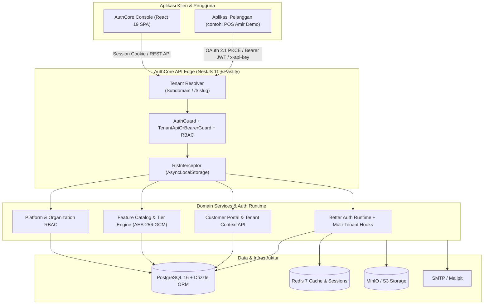

---

## 3. Client

Ekosistem sisi klien **AuthCore** terdiri dari konsol web terpadu (`auth-core-console`) dan aplikasi klien referensi (`pos-amir-demo`), ditambah pustaka komponen Auth UI mandiri.

### A. AuthCore Console (`auth-core-console`)

Single-Page Application (SPA) berbasis React 19 + Vite yang menyediakan tiga permukaan antarmuka dalam satu aplikasi:

1. **Platform Operator Console (`/platform/*`)**
   - **Overview (`/platform`)**: Ringkasan jumlah tenant, tenant ditangguhkan, akses cepat ledger tagihan, dan daftar tenant terbaru dengan mode dukungan (*support mode*).
   - **Tenants Directory (`/platform/tenants`)**: Manajemen tenant lintas pelanggan (buat tenant, ubah tier, suspend/activate, filter status & tier).
   - **Feature & Tier Matrix (`/platform/tiers`)**: Matriks interaktif untuk mengatur status fitur (`Active`, `Disabled`, `Coming Soon`) dan hak akses fitur pada 4 tier (`Free`, `Basic`, `Business`, `Enterprise`).
   - **Billing Ledger (`/platform/billing`)**: Pencatatan dan pemantauan histori tagihan tenant.
   - **Account & Staff Directory (`/platform/users`, `/platform/staff`)**: Direktori akun platform dan manajemen staf operator beserta aksi *ban/unban*.
   - **Platform Roles (`/platform/roles`)**: Editor matriks permission berbasis *resource:action* untuk peran operator (`auth_core_role`) lengkap dengan pratinjau kode `createAccessControl`.
   - **Staff Sessions & Audit Platform (`/platform/sessions`, `/platform/audit`)**: Pemantauan sesi aktif dan aliran log audit tervirtualisasi (`react-virtuoso`).
   - **Auth Features Manager (`/platform/auth-features`)**: Pengaturan runtime 54 modul Better Auth, penerapan preset arsitektur (`minimal`, `saas`, `enterprise`, `full`), dan ekspor kode (`auth.ts`, `auth-client.ts`, `.env`).

2. **Customer Portal (`/tenants` & `/tenants/:tenantId/*`)**
   - Manajemen tenant mandiri oleh pemilik aplikasi: Ringkasan & *Hosted Login URL*, Pengaturan Tenant, Konfigurasi Fitur IAM & Secret per Tenant, Aplikasi Terhubung (OAuth 2.1 Clients dengan batas tier), Tenant API Keys, Daftar User Tenant Terisolasi, Daftar Organization, Editor Role & Permission Organisasi (`Templates`, `Role organisasi`, `Katalog`), serta Ringkasan Billing.

3. **Hosted Authentication UI (`/login`, `/register`, `/verify-2fa`, `/consent`, dan `/t/:tenantSlug/*`)**
   - Halaman autentikasi beranimasi (*Animated Split Layout* dengan `AnimatedAuthBackground` dan maskot 3D *glossy shield* `AuthMascot`) untuk akun platform maupun halaman login *hosted* per tenant (`/t/:tenantSlug/login`, `register`, `verify-2fa`, `consent`, `accept-invitation`).
   - Seluruh metode login (Password, Email OTP, Magic Link, Passkey, Social OAuth) dirender secara reaktif mengikuti konfigurasi fitur aktif di platform maupun tier tenant.

4. **Independent Auth UI Library (`src/components/better-auth/`)**
   - Komponen siap pakai: `AuthUIProvider`, `AuthView`, `AccountView`, `OrganizationView`, `UserButton`, `OrganizationSwitcher`, serta route guards (`SignedIn`, `SignedOut`, `RedirectToSignIn`).
   - Mendukung **Multi-Tone Enterprise Design System** (8 palet warna Tailwind CSS v4, mode Light/Dark/System, dan kustomisasi tata letak navigasi).

### B. Aplikasi Klien Referensi (`pos-amir-demo`)

Aplikasi demonstrasi (*POS Amir*) yang berjalan terpisah di atas Bun HTTP Server (`localhost:3100`) untuk membuktikan integrasi nyata aplikasi eksternal dengan AuthCore tanpa menginstal Better Auth di sisi klien:

- **OAuth 2.1 Authorization Code + PKCE**: Mengarahkan end-user ke `/t/pos-amir/login` dan `/t/pos-amir/consent`, menerima `authorization_code` di `/callback`, menukarnya menjadi JWT, dan membedah *decoded JWT claims* (`tenant_id`, `active_organization_id`, `org_role`, `org_permissions`).
- **Real-Time Context Verification**: Memanggil `/api/context/session` dan `/api/context/organizations` menggunakan `Authorization: Bearer <JWT>` maupun server-to-server `x-api-key`.
- **Organization & Member Flow**: Membuat *organization* baru (cabang/warung), mengganti *active organization*, dan mengundang staf langsung melalui API Better Auth bertingkat tenant.
- **Live End-to-End Trace Panel**: Mencatat seluruh pertukaran request/response secara *real-time* untuk keperluan inspeksi integrasi.

---

## 4. Service (`auth-core-api`)

Backend **AuthCore** dibangun sebagai **Modular Monolith** idiomatik NestJS 11 di atas Fastify dengan penegakan prinsip SOLID serta aturan batas modul via ESLint (`modular-monolith/no-cross-module-import`).

### Daftar Modul & Layanan Utama

| Modul (`src/modules/*`) | Endpoint / Jalur Utama | Tanggung Jawab Layanan |
| :--- | :--- | :--- |
| **`auth`** | `/api/auth/*`, `/api/social-bridge/*` | Orkestrasi instance dinamis `betterAuth()` (`AuthRuntimeRegistry`), katalog 54 fitur, hook isolasi multi-tenant (`better-auth-multi-tenant` + model read/write guard), hashing password `argon2`, clamping TTL access token (300–900 detik), serta **Social OAuth Bridge** untuk callback terpusat yang kembali ke host tenant asal. |
| **`tenant`** | `/api/admin/tenants/*` | CRUD tenant, validasi *reserved slug*, perubahan tier (`configVersion` increment), suspensi/aktivasi tenant dengan invalidasi cache slug, serta *Fastify URL rewrite & host resolver hook* (mode subdomain `<slug>.domain` maupun path `/t/:slug`). |
| **`tenant-context`** | `/api/context/*` | API verifikasi konteks *real-time* untuk aplikasi klien (`/api/context/session`, `/api/context/organizations`, `/api/context/organizations/:id/members`) yang diamankan oleh `TenantApiOrBearerGuard` (mendukung OAuth Bearer JWT dan Tenant `x-api-key`). |
| **`customer-portal`** | `/api/portal/tenants/*` | Layanan *self-service* pemilik tenant (`TenantOwnerGuard`): manajemen tenant, OAuth clients (penegakan kuota 1 client di tier `Free`), Tenant API Keys, daftar user/organization terisolasi per tenant, konfigurasi fitur tenant, dan manajemen RBAC organisasi. |
| **`feature-tier`** | `/api/admin/features`, `/api/admin/tiers` | Mesin konfigurasi 4 lapis (`auth_features`, `auth_feature_config`, `auth_tiers` + `auth_tier_features`, `tenant_auth_feature_config`), enkripsi *secret* per tenant dengan **AES-256-GCM** (`CryptoModule`), dan invalidasi `catalogVersion` O(1). |
| **`rbac`** | `/rbac/*`, `@RequirePlatformPermission` | Pengelolaan role platform (`auth_core_role`), katalog permission organisasi dinamis (`organization_permission`), template role (`organization_role_template`), role kustom organisasi (`organization_role` + `permissionScopes`), serta `RlsInterceptor` / `RlsContext`. |
| **`member`** | `/admin/members/*` | Pengelolaan keanggotaan organisasi aktif, undangan anggota, serta `MemberAcceptedBridge` saat undangan diterima. |
| **`billing`** | `/api/admin/billing/*` | Ledger pencatatan transaksi tagihan tenant dan sinkronisasi `tenant.billingStatus`. |
| **`platform-console`** | `/api/authcore/*`, `/api/auth-config` | Endpoint konsol operator (metrik KPI, direktori user lintas/platform, staf, role, sesi aktif, audit trail, serta pembaruan konfigurasi fitur global). |
| **`email`, `upload`, `health`** | `/uploads/*`, `/health/*`, `/docs` | Pengiriman email HTML (verifikasi, reset password, undangan organisasi), unggah berkas ke S3/MinIO via `IObjectStorageService`, Terminus readiness/liveness probe (PostgreSQL & Redis), serta dokumentasi OpenAPI/Scalar (mode development). |

---

## 5. Tech Stack

| Lapisan | Teknologi & Versi (dari `package.json` & `docker-compose.yml`) |
| :--- | :--- |
| **Runtime & Package Manager** | Bun `1.3.14`, TypeScript (`^5.7.0` API / `~5.8.3` Console) |
| **Backend Framework** | NestJS `^11.0.0`, Fastify `^5.0.0` (`@nestjs/platform-fastify`), `@fastify/helmet`, `@fastify/rate-limit`, `@fastify/compress`, `@fastify/multipart` |
| **IAM & Auth Engine** | Better Auth `^1.7.27`, `@thallesp/nestjs-better-auth` `^2.7.0`, `better-auth-multi-tenant` `^0.7.0`, `@better-auth/passkey`, `@better-auth/api-key`, `@better-auth/oauth-provider`, `@better-auth/sso`, `@better-auth/scim`, `@better-auth/mcp`, `@better-auth/agent-auth`, `@better-auth/stripe`, `@better-auth/i18n` |
| **Database & ORM** | PostgreSQL 16 (`postgres:16-alpine`), Drizzle ORM `^0.45.2`, `drizzle-kit` `^0.31.10`, `pg` `^8.13.0` |
| **Cache & Secondary Storage** | Redis 7 (`redis:7-alpine`), `ioredis` `^5`, `@keyv/redis` `^5`, `@better-auth/redis-storage` `^1.7.27` |
| **Security & Validation** | `argon2` `^0.45.1`, AES-256-GCM (`node:crypto`), `zod` `^3.24.0`, `class-validator` `^0.14.1`, `class-transformer` `^0.5.1` |
| **Frontend Framework & Routing** | React `^19.1.0`, Vite `^7.3.0`, TanStack Router `^1.120.2`, TanStack Query `^5.76.1`, TanStack Table `^8.21.3` |
| **Frontend State, UI & Motion** | Zustand `^5.0.5`, React Hook Form `^7.56.4`, Tailwind CSS v4 (`@tailwindcss/vite` `^4.1.7`), Radix UI Primitives, Framer Motion `^14.14.0`, `lucide-react`, `@iconify/react`, Recharts `^2.15.3`, `react-virtuoso` `^4.12.7`, `input-otp`, `sonner` |
| **Observability, Docs & Infra** | Winston `^3.19.0` + `winston-daily-rotate-file`, Prometheus (`@willsoto/nestjs-prometheus`), `@nestjs/terminus`, `@nestjs/swagger` + `@scalar/nestjs-api-reference`, `nestjs-i18n`, MinIO / S3 (`@aws-sdk/client-s3`), Mailpit (`axllent/mailpit:v1.27`), Docker Compose |

---

## 6. Features

### A. Katalog 54 Fitur & Plugin Autentikasi (7 Kategori)

Seluruh fitur dikelola melalui katalog terpusat dan dapat diaktifkan/dinonaktifkan secara dinamis sesuai tier atau konfigurasi platform:

1. **Core & Session (5 Modul)**:
   `Email & Password` (Argon2), `Email Verification`, `Account Linking`, `Session Management` (rolling window + cookie cache), dan `Rate Limiting` berbasis Redis secondary storage.
2. **Authentication Methods (10 Modul)**:
   `Two-Factor Auth (2FA)` (TOTP 6-digit + Backup Codes), `Passkey (WebAuthn)`, `Magic Link`, `Email OTP`, `Username Auth`, `Phone Number & SMS OTP`, `Anonymous Guest Auth`, `Google One Tap`, `SIWE (Sign-In With Ethereum)`, dan `Generic OAuth / OIDC`.
3. **Social OAuth Providers (13 Modul)**:
   `Google`, `GitHub`, `Microsoft`, `Apple`, `Discord`, `GitLab`, `Slack`, `LinkedIn`, `X / Twitter`, `Figma`, `Notion`, `Linear`, dan `Vercel` — dilengkapi **Social Bridge** untuk menangani *callback* OAuth secara terpusat lalu mengembalikan sesi aman ke host tenant asal.
4. **RBAC & Multi-Tenant (4 Modul)**:
   `Admin` (user management, ban/unban, impersonation), `Organization` (multi-workspace, teams, invitations, member roles), `API Key` (terikat `tenant_id` & rate-limited), dan `Agent Auth` (`@better-auth/agent-auth` untuk otorisasi agen AI).
5. **OIDC & Enterprise (5 Modul)**:
   `OAuth 2.1 / OIDC Provider` (Authorization Code + PKCE + JWKS), `MCP (Model Context Protocol)` Auth, `Device Authorization Flow`, `Enterprise SSO` (SAML 2.0 / OIDC), dan `SCIM 2.0` Provisioning.
6. **Security & Utility (11 Modul)**:
   `Bearer Token`, `JWT / JWKS`, `Multi-Session` (hingga 5 akun di satu perangkat), `Captcha Protection` (Cloudflare Turnstile / hCaptcha / reCAPTCHA), `Have I Been Pwned (HIBP)` password leak check, `Last Login Method`, `One-Time Token`, `OAuth Proxy`, `OpenAPI / Scalar Docs`, `i18n` (`id` & `en`), serta `Audit Logs`.
7. **Payments & Billing Plugins (6 Modul)**:
   Dukungan integrasi plugin pembayaran Better Auth: `Stripe`, `Polar`, `Autumn`, `Dodo Payments`, `Creem`, dan `Chargebee`.

### B. Kapabilitas Unggulan Arsitektur Produk

- **Isolasi Tenant Berlapis**: Pemisahan *user pool* (`(tenant_id, email)` unik per tenant), sesi, kode verifikasi, API key, OAuth client, dan organization antar tenant. Sesi dari tenant A otomatis ditolak (`403`) di host tenant B.
- **4-Tier Feature Gating & Encrypted Tenant Secrets**: Matriks `Free`, `Basic`, `Business`, dan `Enterprise` mengunci ketersediaan fitur IAM per tenant. Setiap *secret* (misalnya `clientSecret` Google/GitHub per tenant) dienkripsi menggunakan **AES-256-GCM** dan tidak pernah bocor dalam plaintext pada respons API.
- **Dual-Layer RBAC**: Pemisahan penuh antara **Platform RBAC** (izin staf operator AuthCore) dan **Organization RBAC** (izin bisnis untuk setiap toko/workspace di dalam tenant, yang dapat dibaca aplikasi klien via JWT claims atau `/api/context/session`).
- **Two-Mode Tenant Resolution**: Mendukung mode *subdomain* (`pos-amir.authcore.local`) maupun mode *path* (`/t/pos-amir`) langsung dari Fastify `rewriteUrl`.

---

## 7. Screenshots (11 Tangkapan Layar Unggulan)

Berikut adalah tangkapan layar unggulan yang diambil langsung dari aplikasi AuthCore (`auth-core-console`, `auth-core-api`, dan `pos-amir-demo`) yang berjalan pada environment lokal:

### 1. Platform Split Login & 3D Shield Mascot (`/login`)
Halaman autentikasi dua panel dengan latar kanvas *silk-ribbon* animatif, maskot 3D *shield*, pemilihan palet warna tema, mode *Password / OTP / Magic Link*, tombol *Demo Super Admin*, dan *Social OAuth* yang menyesuaikan modul aktif secara reaktif.

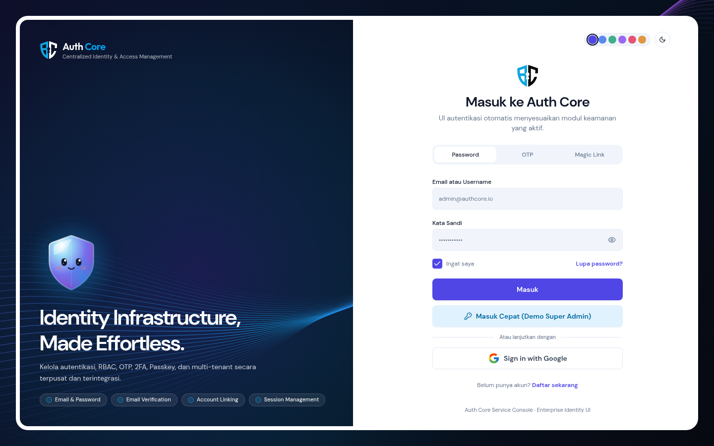

### 2. Hosted Tenant Authentication Page (`/t/pos-amir/login`)
Halaman login terisolasi khusus untuk tenant **`pos-amir`** (tier *Business*). Menampilkan metode masuk yang aktif pada tier dan konfigurasi tenant tersebut (Password, Email OTP, Magic Link, Passkey WebAuthn, Google, dan GitHub).

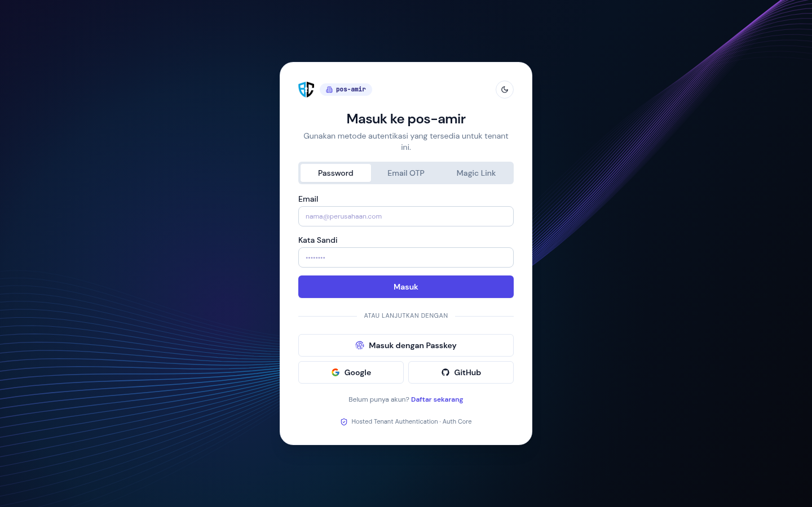

### 3. Platform Operator Overview (`/platform`)
Meja kerja utama operator platform yang menampilkan jumlah tenant aktif, tenant ditangguhkan, akses cepat ke *Billing Ledger*, daftar tenant terbaru lengkap dengan badge status, tier, dan tombol masuk ke mode dukungan.

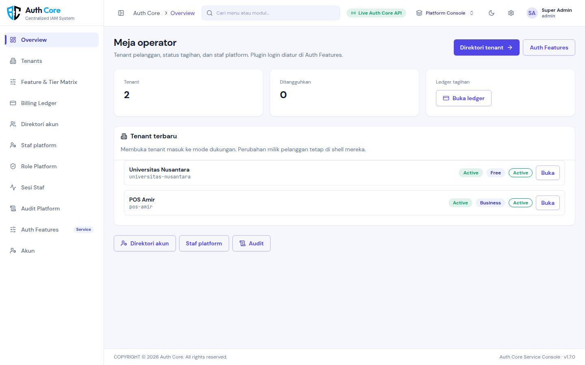

### 4. Multi-Tenant Directory & Lifecycle Management (`/platform/tenants`)
Direktori manajemen seluruh tenant pelanggan (`Universitas Nusantara`, `POS Amir`), lengkap dengan metrik filter, versi konfigurasi (`configVersion`), status billing, serta kontrol pembuatan tenant, perubahan tier, dan suspensi.

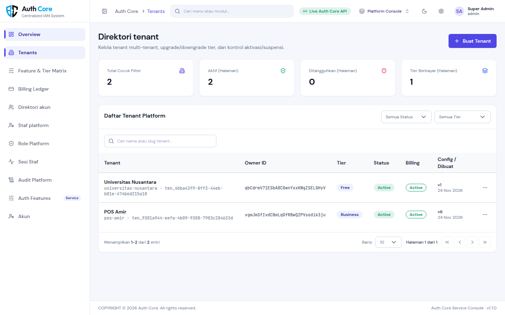

### 5. Feature & Subscription Tier Matrix (`/platform/tiers`)
Matriks kendali operator untuk mengatur status ketersediaan 54 fitur katalog (`Active`, `Disabled`, `Coming Soon`) serta pemetaan hak akses fitur ke dalam 4 tier langganan (`Free`, `Basic`, `Business`, `Enterprise`) dengan invalidasi cache otomatis.

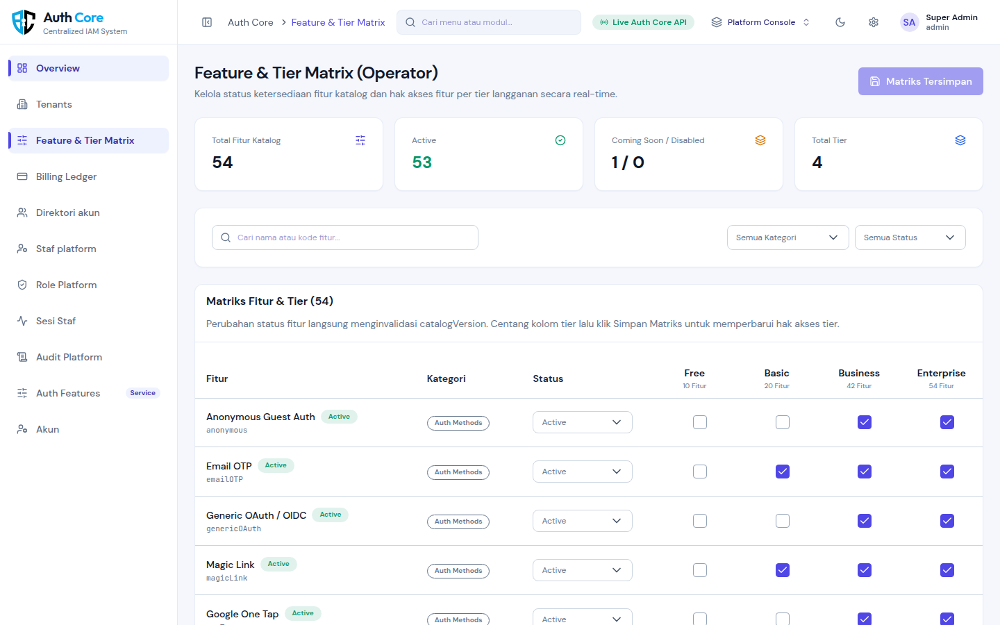

### 6. Auth Core Feature & Plugin Manager (`/platform/auth-features`)
Pengelola runtime 54 fitur & plugin Better Auth lintas 7 kategori (*Core & Session*, *Auth Methods*, *Social OAuth*, *RBAC & Tenant*, *OIDC & Enterprise*, *Security & Utility*, *Payments*) beserta fitur *Preset* dan *Export Config* (`auth.ts`, `auth-client.ts`, `.env`).

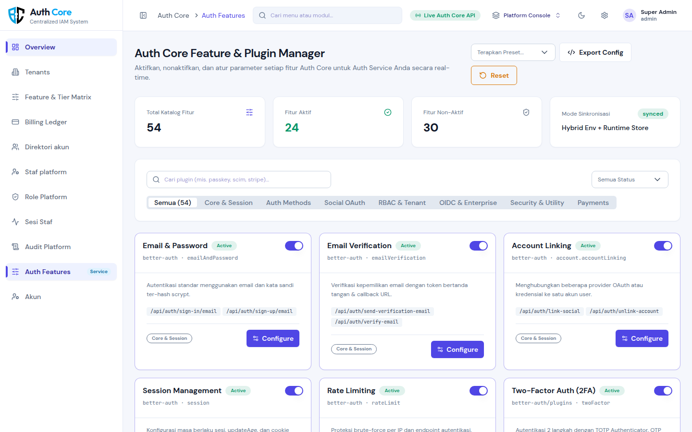

### 7. Tenant Workspace & Customer Portal (`/tenants/:tenantId`)
Ruang kerja terisolasi milik tenant **`POS Amir`** yang menampilkan *Hosted Login URL*, pengelolaan OAuth 2.1 Clients (*Aplikasi terhubung*), *Tenant API Keys* (*Kunci server*), manajemen pengguna & organisasi tenant, serta banner informasi saat diakses operator dalam mode dukungan.

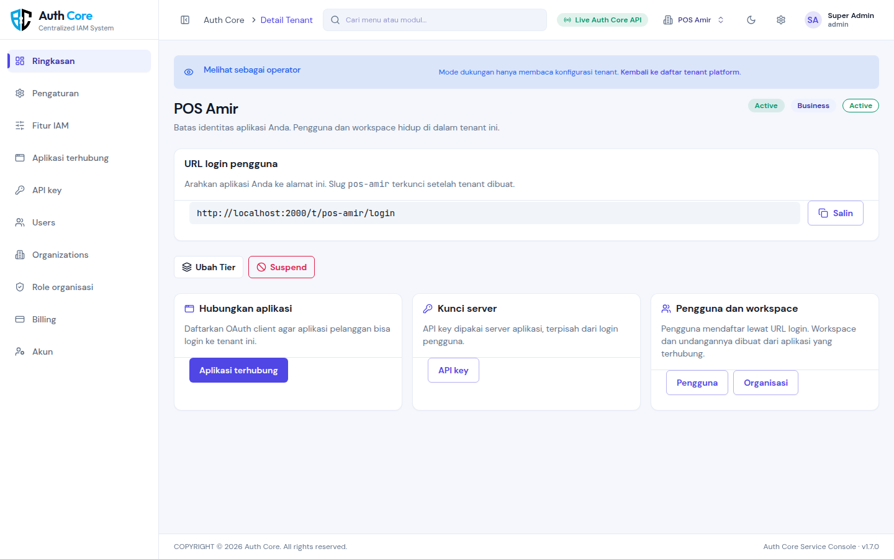

### 8. Dynamic Roles & RBAC Permissions Editor (`/platform/roles`)
Editor matriks izin berbasis *resource:action* untuk mendefinisikan hak akses setiap role (`Super Admin`, `Administrator`, `Security Admin`, `Org Manager`, `Support Agent`, `Compliance Auditor`) beserta tab generator kode `createAccessControl`.

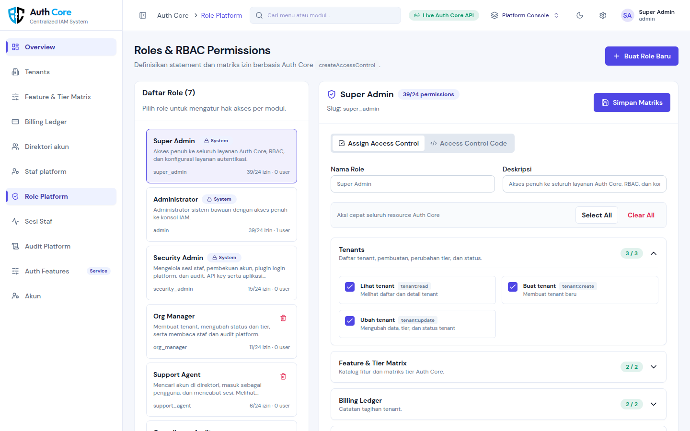

### 9. Virtualized Security Audit Logs (`/platform/audit`)
Aliran catatan jejak audit keamanan tervirtualisasi (`react-virtuoso` + `useInfiniteQuery`) dengan filter pencarian aktor/IP, tingkat *severity*, kategori event, dan rentang tanggal.

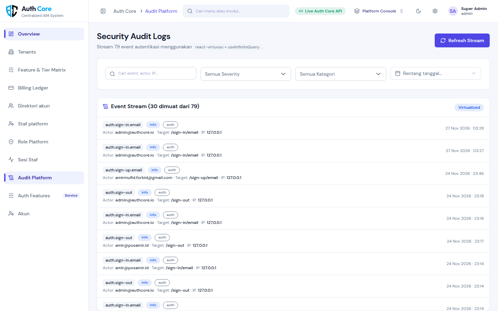

### 10. Client Application Integration — POS Amir Demo (`http://localhost:3100`)
Aplikasi klien nyata (**POS Amir**) yang terhubung ke tenant `pos-amir` menggunakan OAuth 2.1 + PKCE, verifikasi sesi & izin *real-time* via `/api/context/session` (`Bearer JWT` / `x-api-key`), manajemen *organization* & undangan staf, serta panel *Trace Request/Response End-to-End*.

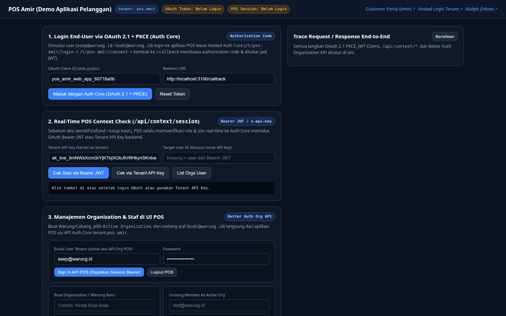

### 11. OpenAPI 3.1.1 / Scalar API Reference (`http://localhost:2001/docs`)
Dokumentasi interaktif seluruh endpoint REST API dan Better Auth pada **AuthCore API** yang dihasilkan secara otomatis menggunakan OpenAPI 3.1.1 dan Scalar UI.

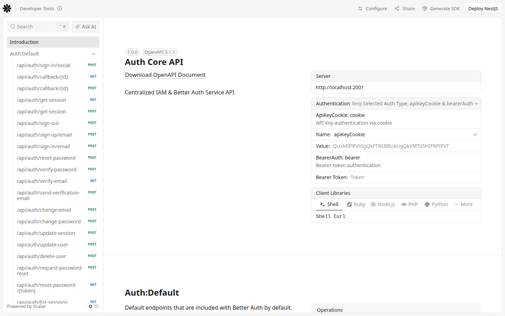
