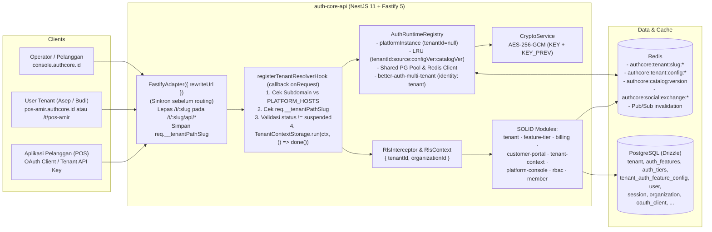

# Design Document: Auth Core Multi-Tenant IAM Architecture (Fase 0–5)

- **Tanggal:** 24 November 2026
- **Status:** Approved (Hasil Wawancara Desain `/grill-me` + Patch Teknis v1.2)
- **PRD Acuan:** [2026-11-24-auth-core-prd.md](../../../../2026-11-24-auth-core-prd.md)
- **Spec Internal Terkait:**
  - [2026-11-20-modular-solid-architecture-design.md](./2026-11-20-modular-solid-architecture-design.md)
  - [2026-11-23-database-seeder-design.md](./2026-11-23-database-seeder-design.md)

> [!IMPORTANT]
> Dokumen ini **menggantikan secara resmi** pendekatan desain lama yang menyimpan nilai `plan` (`Free`, `Pro`, `Enterprise`) pada `organization.metadata` dan memperlakukan `organization` sebagai tenant. Tier layanan Auth Core melekat pada entitas `tenant` (`Free`, `Basic`, `Business`, `Enterprise`), sedangkan `organization` adalah workspace milik user tenant di dalam sebuah `tenant`.

---

## 1. Konteks & Keputusan Arsitektur Utama

Berdasarkan PRD dan kesepakatan desain `/grill-me`, berikut 9 keputusan arsitektur yang dikunci untuk seluruh fase implementasi (Fase 0–5):

1. **Cakupan & Strategi Migrasi DB:** Seluruh arsitektur Fase 0–5 dirancang dalam satu spec terpadu dan dieksekusi bertahap per fase. Karena proyek masih dalam tahap pengembangan awal, reset/rebuild baseline migrasi Drizzle diizinkan pada saat restrukturisasi schema inti (dieksekusi di Fase 0 agar kolom `tenant_id` dan tabel `auth_tiers` tersedia sebelum modul lain dibangun).
2. **Runtime Better Auth per Tenant + Redis Cache:** Source of truth konfigurasi fitur, tier, dan secret terenkripsi berada di PostgreSQL. Konfigurasi efektif per tenant beserta `configVersion` (tanpa plaintext secret) dan `catalogVersion` global di-cache di **Redis**, dan in-process `AuthRuntimeRegistry` memelihara 1 instance **Platform** plus LRU cache instance Better Auth per **`${tenantId}:${source}:${configVersion}:${catalogVersion}`** (`source: 'subdomain' | 'path'`) dengan **berbagi satu Drizzle/PostgreSQL `Pool` dan satu koneksi Redis yang sama**.
3. **Resolusi Tenant Ganda (Fastify 5 `rewriteUrl` + Callback `onRequest`) & Base Path `/api/auth`:** Mendukung **subdomain** (`<slug>.<TENANT_BASE_DOMAIN>`) sebagai mode utama dan **path fallback** (`/t/<slug>/...`) secara bersamaan melalui dua tahap di Fastify 5: `FastifyAdapter({ rewriteUrl })` (sinkron sebelum routing `find-my-way` untuk melepas `/t/<slug>` pada seluruh `/t/<slug>/api/*`) diikuti callback `fastify.addHook('onRequest', (req, reply, done) => ...)` yang mengikat `TenantContextStorage` (`AsyncLocalStorage`). Host platform (`PLATFORM_HOSTS`) di-bypass ke konteks Platform. Base path Better Auth distandardisasi ke **`/api/auth`** di API dan Console. Di mode path, setiap tenant menggunakan `cookiePrefix` unik per slug (`ac_t_<slug>`) dan `Path=/t/<slug>` agar sesi antar-tenant maupun Platform tidak saling menimpa.
4. **Uniqueness User & Aturan Organization:** `email`, `username`, dan `phone_number` bersifat unik per `(tenant_id, <kolom>)` untuk user tenant, serta unik terpisah untuk akun platform (`WHERE tenant_id IS NULL`), dideklarasikan langsung di TypeScript Drizzle schema dengan `uniqueIndex(...).on(...).where(sql\`...\`)`. `organization.slug`unik per`(tenant_id, slug)`. Seluruh user tenant aktif diperbolehkan membuat organization baru (dibatasi `organizationLimit`tenant), termasuk user yang sudah menjadi`member` di organization lain.
5. **Integrasi Aplikasi Pelanggan (POS):** Menggunakan **OAuth 2.1 / OIDC Bearer Token + Tenant Context API**. JWT Access Token (TTL pendek 5–15 menit), ID Token, `/userinfo`, dan `/api/context/session` membawa `sub`/`user_id`, `tenant_id`, `active_organization_id`, `org_role`, dan `org_permissions`. Operasi organization dapat dipanggil dengan Bearer token user maupun **Tenant API Key** (server-to-server).
6. **Katalog Fitur 4-Lapis & Kebijakan Downgrade:** Seluruh 54 fitur katalog Better Auth di-seed ke `auth_features` (fitur yang belum tersedia seperti `autumn` berstatus `coming_soon`). Saat tier tenant diturunkan atau fitur di-nonaktifkan oleh Operator, enforcement bersifat **fail-closed non-destruktif**: fitur mati saat resolusi runtime, sementara baris konfigurasi dan ciphertext secret tenant tetap tersimpan utuh di DB bila nanti di-upgrade kembali.
7. **Pembayaran Platform:** Rilis ini menggunakan **Manual Tier & Billing Ledger** (`tenant_billing_records`): Operator menetapkan/mengubah tier serta mencatat status tagihan (`active`, `trialing`, `past_due`, `suspended`, `manual_invoice`), sementara Pelanggan melihat tier aktif dan riwayat tagihan secara read-only. Plugin payment gateway otomatis tetap opsional di sisi platform.
8. **Frontend 3 Permukaan dalam 1 Aplikasi:** `auth-core-console` melayani 3 konteks route di TanStack Router:
   - **Operator Console** (dilindungi permission `auth_core_role`),
   - **Portal Pelanggan Amir** (`/tenants/*`, untuk akun platform yang memiliki/membuat tenant),
   - **Hosted Tenant Auth Pages** (`/t/$tenantSlug/login`, `/register`, `/verify-2fa`, `/consent`, `/accept-invitation` + deteksi otomatis berbasis subdomain).
9. **Refactor Bertahap sesuai Spec SOLID:** Modul baru (`tenant`, `feature-tier`, `billing`, `customer-portal`, `tenant-context`) dibangun murni mengikuti spec SOLID (SRP ≤300 baris/service, DIP repository interface + injection token, pagination/filter di DB). Pada Fase 0, `AuthConsoleService` (1.594 baris) dipecah ke modul `platform-console`, guard permission `auth_core_role` ditegakkan, dan bug IDOR/secret/path diperbaiki.

---

## 2. Arsitektur Sistem & Resolusi Request



### 2.1 Aturan Resolusi Tenant (Fastify 5 `rewriteUrl` + Callback `onRequest`)

> [!NOTE]
> Di Fastify 5, pencocokan route (`find-my-way`) berjalan **sebelum** `onRequest` hook, dan hook `onRequest` bertipe `async` keluar dari konteks `AsyncLocalStorage` sebelum handler controller/Better Auth dieksekusi. Oleh karena itu, resolusi tenant wajib menggunakan kombinasi dua tahap berikut (dan diuji dengan concurrent parallel request 2 tenant sejak Fase 2):

1. **Tahap 1 — `FastifyAdapter({ rewriteUrl })` (Sinkron, Sebelum Routing):**
   - `createTenantRewriteUrl()` memeriksa URL mentah: jika diawali `/t/<slug>/api/` (berlaku generik untuk **seluruh** `/t/<slug>/api/*`, termasuk `/api/auth/*`, `/api/context/*`, `/api/auth-config`, dan `/api/social-bridge/*`), fungsi menyimpan `req.__tenantPathSlug = slug` dan `req.__tenantOriginalUrl = req.url`, **menormalisasi `req.url` / `req.raw.url`** dengan melepas prefix `/t/<slug>` agar sinkron baik untuk router Fastify maupun konversi Web `Request` pada `@thallesp/nestjs-better-auth` (`basePath: '/api/auth'`), lalu mengembalikan path hasil rewrite tersebut sebelum routing `find-my-way` berjalan.
2. **Tahap 2 — `fastify.addHook('onRequest', (req, reply, done) => ...)` (Callback-Style, Bukan `async`):**
   - **Host Check (Subdomain aktif di Fase 5; Platform Bypass aktif sejak Fase 2):** Ambil header `host` (atau `x-forwarded-host` karena `trustProxy: true`), normalisasi hostname tanpa port. Jika hostname cocok dengan `PLATFORM_HOSTS` atau tepat sama dengan `TENANT_BASE_DOMAIN` / `auth.<TENANT_BASE_DOMAIN>` / `console.<TENANT_BASE_DOMAIN>`, resolusi host dianggap **Platform**. Jika berakhiran `.<TENANT_BASE_DOMAIN>` dan bukan reserved host, ekstrak `hostSlug`.
   - **Mismatch Check:** Jika `hostSlug` dan `req.raw.__tenantPathSlug` keduanya ada dan berbeda, balas `400 TENANT_MISMATCH`.
   - **Lookup & Status Validation:** Untuk `slug = hostSlug ?? req.raw.__tenantPathSlug`, ambil metadata ringkas `{ id, slug, status, tierId, configVersion }` dari Redis (`authcore:tenant:slug:<slug>`) dengan fallback PostgreSQL. Jika tidak ditemukan → `404 TENANT_NOT_FOUND`. Jika `status === 'suspended'` → `403 TENANT_SUSPENDED`.
   - **Pengikatan ALS:** Di dalam callback `.then(...)`, panggil `TenantContextStorage.run(resolvedContext, () => done())` (dan lampirkan `req.tenantContext = resolvedContext`) sehingga konteks ALS hidup sepanjang seluruh lifecycle request Fastify dan raw handler Better Auth.
3. **Reserved Slugs & Slug Immutability:**
   - Daftar `RESERVED_TENANT_SLUGS` yang ditolak saat pembuatan tenant dan tidak pernah dianggap subdomain tenant: `auth`, `console`, `api`, `admin`, `www`, `t`, `app`, `docs`, `mail`, `status`, `oauth`, `sso`, `scim`, `billing`, `static`.
   - **`tenant.slug` bersifat immutable** setelah tenant dibuat. Upaya mengubah `slug` via `PATCH` ditolak dengan `400 TENANT_SLUG_IMMUTABLE`.
4. **Isolasi Cookie di Mode Path (`/t/:slug`) vs Subdomain:**
   - Karena semua tenant di mode path `/t/:slug` berbagi origin host yang sama, setiap instance Better Auth tenant di mode path wajib mengonfigurasi `advanced.cookiePrefix` unik per slug (`ac_t_${slug}`) dan atribut cookie `path: '/t/' + slug`, sementara instance Platform memakai `cookiePrefix: 'ac_platform'` dengan `path: '/'`. Pada mode subdomain, cookie tetap bersifat _host-only_ (`Domain` tidak disetel ke wildcard `.authcore.id`) dengan prefix `ac_t_${slug}` agar sesi tenant A tidak pernah terbaca oleh tenant B maupun Console Platform.

### 2.2 Per-Tenant Better Auth Runtime (`AuthRuntimeRegistry`)

Menggantikan `AuthRuntimeHolder` tunggal menjadi `AuthRuntimeRegistry` yang tetap membungkus proxy kompatibel dengan `@thallesp/nestjs-better-auth`:

- **Shared Connection Pools (Aturan Keras):**
  - Seluruh hingga 200 instance `betterAuth(...)` di dalam LRU cache **wajib berbagi satu Drizzle/PostgreSQL pool (`getSharedPool()`) dan satu client `ioredis` (`BETTER_AUTH_REDIS_CLIENT`) yang sama**. Factory `createAuthInstance` dilarang keras membuat instance `pg.Pool` atau client Redis baru per tenant.
- **Konteks Platform (`tenantId = null`):**
  - Dibangun dari `auth_feature_config` + fallback env platform (`GOOGLE_CLIENT_ID`, `GOOGLE_CLIENT_SECRET`, `CAPTCHA_SECRET_KEY`, dll.).
  - Tidak mengizinkan login user yang memiliki `user.tenant_id IS NOT NULL` (isolasi akun platform vs user tenant).
- **Konteks Tenant (`tenantId = string`):**
  - Mengambil resolved config dari Redis (`authcore:tenant:config:<tenantId>`) atau menyusunnya dari DB (`auth_features` + `auth_tier_features` + `tenant_auth_feature_config`).
  - **Keamanan Redis Cache:** Redis hanya menyimpan ciphertext `secrets` (bukan plaintext). Dekripsi AES-256-GCM terjadi hanya di memori proses Node/Bun sesaat sebelum membangun instance `betterAuth(...)`.
  - **Tanpa Fallback Env untuk Secret Tenant:** Jika tenant belum mengonfigurasi secret (mis. `socialGoogle.clientSecret`), provider tersebut **tidak aktif** untuk tenant itu — tidak boleh jatuh ke `process.env.GOOGLE_CLIENT_SECRET`.
  - **Kebijakan WebAuthn Passkey `rpID`:** Default `rpID` tenant dikunci ke registrable base domain `TENANT_BASE_DOMAIN` (mis. `authcore.id`, atau `localhost` saat dev) sehingga kredensial Passkey yang didaftarkan user di mode `/t/:slug` tetap valid saat tenant beralih ke subdomain `<slug>.authcore.id`, sementara validasi `origin` tetap ketat terhadap origin tenant aktif.
  - **Isolasi Plugin Multi-Tenant:** Menggunakan `better-auth-multi-tenant` dengan `identity: "tenant"` (tanpa `getOrganizationId`) untuk mengikat `session.tenantId`, menolak session silang tenant, dan menolak user platform di host tenant.
- **LRU Cache & Invalidasi O(1):**
  - Redis memelihara counter global `authcore:catalog:version` (`catalogVersion`). Perubahan pada `auth_features.status` atau `auth_tier_features` cukup melakukan `INCR authcore:catalog:version` secara **O(1)** (tanpa bulk `UPDATE` ke seluruh baris tabel `tenant`).
  - Perubahan konfigurasi pada satu tenant menaikkan `tenant.config_version` dan menghapus `authcore:tenant:config:<tenantId>`.
  - Key in-memory LRU cache (`max = 200`, configurable via `AUTH_RUNTIME_LRU_MAX`) adalah **`${tenantId}:${source}:${tenant.configVersion}:${catalogVersion}`** (`source: 'subdomain' | 'path'`), sehingga instance mode `path` (`Path=/t/<slug>`, `baseURL` ber-prefix `/t/<slug>`) dan mode `subdomain` (`Path=/`, `baseURL` subdomain) terisolasi sempurna meski pada tenant yang sama. Perubahan disinkronkan lintas replika melalui Redis Pub/Sub `authcore:config:invalidated`.

### 2.3 Central OAuth Social Callback dengan One-Time Exchange Code (PRD §15)

Untuk social provider yang tidak mendukung wildcard subdomain redirect URI (mis. Google, GitHub, Microsoft):

- `redirectURI` resmi didaftarkan pada host tunggal platform: `https://auth.<TENANT_BASE_DOMAIN>/api/social-bridge/callback/:provider` (atau env `SOCIAL_CALLBACK_BASE_URL`).
- **Larangan Penerbitan Cookie Lintas Host & Anti Open Redirect:**
  - Host pusat `auth.*` **tidak boleh** menerbitkan `Set-Cookie` sesi tenant secara langsung maupun memakai wildcard cookie domain `.authcore.id`.
  - `createSignedState` **wajib membentuk `returnOrigin` secara murni di sisi server** berdasarkan `tenantSlug`, `mode` (`'subdomain' | 'path'`), dan konfigurasi domain tepercaya (`TENANT_BASE_DOMAIN` / `BETTER_AUTH_URL`) — dilarang menerima `returnOrigin` mentah dari parameter client agar `oneTimeCode` tidak bisa dicuri lewat Open Redirect. Selain itu, field `returnTo` pada `SocialExchangePayload` wajib divalidasi hanya menerima *relative path* aman (diawali `/` dan bukan `//`, pola `/^\/(?!\/)/`) sehingga URL absolut maupun protocol-relative (`//evil.com`) ditolak `400`.
- **Alur 2-Langkah yang Aman:**
  1. Saat user di `pos-amir.authcore.id` (atau `/t/pos-amir`) memulai social login, bridge menandatangani state token (HMAC SHA-256 memakai `BETTER_AUTH_SECRET`) berisi `{ tenantId, tenantSlug, returnOrigin, mode, provider, nonce, returnTo }`.
  2. Setelah provider memanggil callback host tunggal, bridge memverifikasi signature state, mengeksekusi penukaran OAuth code memakai kredensial social terdekripsi milik `tenantId` terkait, lalu menyimpan **one-time exchange code** berumur sangat pendek di Redis (`authcore:social:exchange:<sha256(code)>`, TTL **45 detik**, single-use `GETDEL`) berisi payload identitas/session bootstrap tenant tersebut.
  3. Host pusat me-redirect browser ke endpoint di luar wildcard `/api/auth/*` Better Auth agar tidak dicegat `@thallesp/nestjs-better-auth`:
     - `mode === 'subdomain'` → `${returnOrigin}/api/social-bridge/exchange?code=<oneTimeCode>`
     - `mode === 'path'` → `${returnOrigin}/t/${tenantSlug}/api/social-bridge/exchange?code=<oneTimeCode>` (cookie `Path=/t/${tenantSlug}` tetap mencakup endpoint ini secara penuh).
  4. **Host tenant sendiri** memvalidasi & mengonsumsi exchange code satu kali tersebut. Jika email user sudah terdaftar di tenant tersebut, **auto-linking akun social wajib ditolak (`403 UNVERIFIED_SOCIAL_EMAIL`) apabila `emailVerified === false`** untuk mencegah pengambilalihan akun. Setelah lolos, host tenant membuat baris `session` terikat `tenant_id` dan memasang cookie **host-only** miliknya.

---

## 3. Model Data Target (PostgreSQL + Drizzle ORM)

### 3.1 Entitas Baru

| Tabel                        | File Schema                                         | Kolom Kunci & Relasi                                                                                                                                                                                                                                                                                                                                     |
| :--------------------------- | :-------------------------------------------------- | :------------------------------------------------------------------------------------------------------------------------------------------------------------------------------------------------------------------------------------------------------------------------------------------------------------------------------------------------------- |
| `auth_tiers`                 | `src/database/schema/auth-tier.ts`                  | `id` (`tier_free`, `tier_basic`, `tier_business`, `tier_enterprise`), `code` (unique), `name`, `description`, `sortOrder`, `isDefault`, `createdAt`, `updatedAt`.                                                                                                                                                                                        |
| `auth_features`              | `src/database/schema/auth-feature.ts`               | `id` (UUID PK), `code` (unique, mis. `socialGoogle`), `name`, `description`, `category`, `packageName`, `status` (`active` \| `disabled` \| `coming_soon`), `dependencies` (`text[]`), `availableSetting` (`jsonb`: `{ key, label, type, options?, defaultValue?, required? }[]`), `createdAt`, `updatedAt`.                                             |
| `auth_tier_features`         | `src/database/schema/auth-tier.ts`                  | `tierId` (FK `auth_tiers.id` cascade), `featureId` (FK `auth_features.id` cascade), PK `(tierId, featureId)`.                                                                                                                                                                                                                                            |
| `tenant`                     | `src/database/schema/tenant.ts`                     | `id` (`ten_<uuid>` PK), `name`, `slug` (unique, immutable, lowercase `[a-z0-9-]`), `ownerUserId` (FK `user.id` restrict), `tierId` (FK `auth_tiers.id`), `status` (`active` \| `suspended`), `billingStatus` (`active` \| `trialing` \| `past_due` \| `suspended` \| `manual_invoice`), `configVersion` (`integer default 1`), `createdAt`, `updatedAt`. |
| `tenant_billing_records`     | `src/database/schema/tenant-billing.ts`             | `id` (UUID PK), `tenantId` (FK `tenant.id` cascade), `tierId` (FK `auth_tiers.id`), `status` (`active` \| `trialing` \| `past_due` \| `paid` \| `manual_invoice` \| `void`), `amount` (`integer`), `currency` (`text default 'IDR'`), `periodStart`, `periodEnd`, `note`, `recordedBy` (FK `user.id` set null), `createdAt`.                             |
| `tenant_auth_feature_config` | `src/database/schema/tenant-auth-feature-config.ts` | `tenantId` (FK `tenant.id` cascade), `featureId` (FK `auth_features.id` cascade), PK `(tenantId, featureId)`, `enabled` (`boolean default false`), `settings` (`jsonb`), `secrets` (`jsonb` ciphertext AES-256-GCM), `updatedBy`, `updatedAt`.                                                                                                           |

### 3.2 Perubahan Tabel Eksisting & Isolasi Penuh OAuth 2.1 + Child Tables

1. **`auth_feature_config`** (`src/database/schema/auth-feature-config.ts`):
   - Diubah menjadi khusus konfigurasi login **Platform**.
   - `featureId` (`uuid PK FK -> auth_features.id`), `enabled`, `settings` (`jsonb`), `secrets` (`jsonb` ciphertext AES-256-GCM), `updatedBy`, `updatedAt`.
2. **`user`** (`src/database/schema/better-auth-user.ts`):
   - Tambah `tenantId: text('tenant_id').references(() => tenant.id, { onDelete: 'cascade' })` (nullable). `NULL` = akun platform, `NOT NULL` = user tenant.
   - Hapus constraint `.unique()` global pada `email`, `username`, `phoneNumber`.
   - **Deklarasikan seluruh 6 partial unique index langsung di TypeScript Drizzle schema** memakai `uniqueIndex('...').on(...).where(sql\`...\`)`(dilarang mengedit manual file SQL migrasi hasil`drizzle-kit generate` agar snapshot tidak _drift_):
     - `uq_user_platform_email`: `uniqueIndex('uq_user_platform_email').on(table.email).where(sql\`${table.tenantId} IS NULL\`)`
     - `uq_user_tenant_email`: `uniqueIndex('uq_user_tenant_email').on(table.tenantId, table.email).where(sql\`${table.tenantId} IS NOT NULL\`)`
     - `uq_user_platform_username`: `uniqueIndex('uq_user_platform_username').on(table.username).where(sql\`${table.tenantId} IS NULL AND ${table.username} IS NOT NULL\`)`
     - `uq_user_tenant_username`: `uniqueIndex('uq_user_tenant_username').on(table.tenantId, table.username).where(sql\`${table.tenantId} IS NOT NULL AND ${table.username} IS NOT NULL\`)`
     - `uq_user_platform_phone`: `uniqueIndex('uq_user_platform_phone').on(table.phoneNumber).where(sql\`${table.tenantId} IS NULL AND ${table.phoneNumber} IS NOT NULL\`)`
     - `uq_user_tenant_phone`: `uniqueIndex('uq_user_tenant_phone').on(table.tenantId, table.phoneNumber).where(sql\`${table.tenantId} IS NOT NULL AND ${table.phoneNumber} IS NOT NULL\`)`
3. **`organization`** (`src/database/schema/better-auth-organization.ts`):
   - Tambah `tenantId: text('tenant_id').notNull().references(() => tenant.id, { onDelete: 'cascade' })`.
   - Hapus `.unique()` global pada `slug`; ganti dengan unique composite `uq_organization_tenant_slug` (`uniqueIndex('uq_organization_tenant_slug').on(table.tenantId, table.slug)`).
   - Hapus parsing/penulisan `plan: 'Free' | 'Pro' | 'Enterprise'` di `organization.metadata`.
4. **Seluruh Tabel & Endpoint OAuth 2.1** (`src/database/schema/better-auth-oauth-provider.ts`):
   - Tambah `tenantId: text('tenant_id').references(() => tenant.id, { onDelete: 'cascade' })` + index pada: **`oauth_client`**, **`oauth_access_token`**, **`oauth_refresh_token`**, dan **`oauth_consent`**.
   - `clientSecret` untuk client confidential di-hash sebelum disimpan dan hanya ditampilkan satu kali pada respons pembuatan client.
   - **Guard/Hook Eksplisit OAuth 2.1:** Karena plugin `better-auth-multi-tenant` tidak mengisolasi OAuth provider, seluruh alur `authorize`, `token`, `consent`, `introspect`, dan `revoke` wajib memverifikasi `oauth_client.tenantId === request.tenantContext.tenantId`. Jika `client_id` milik tenant lain (atau platform), tolak dengan `403 CROSS_TENANT_OAUTH_CLIENT`.
5. **Tabel Security & Audit** (`session`, `verification`, `apikey`, `device_code`, `sso_provider`, `audit_trail_logs`):
   - Tambah kolom `tenantId` (nullable FK ke `tenant.id`, `onDelete: 'cascade'` untuk tabel operasional dan `onDelete: 'set null'` untuk `audit_trail_logs`) + index `idx_<table>_tenant_id`.
6. **Child Tables Denormalized `tenant_id` (Kesiapan PostgreSQL Native RLS):**
   - Tambah kolom `tenantId` (nullable FK ke `tenant.id`, `onDelete: 'cascade'`) + index pada tabel anak: **`account`**, **`passkey`**, **`two_factor`**, **`member`**, **`invitation`**, dan **`organization_role`**. Nilai `tenantId` otomatis dipropagasikan dari `user.tenantId` / `organization.tenantId` melalui hook agar siap untuk policy PostgreSQL native RLS (`SET LOCAL app.tenant_id`) tanpa join `EXISTS (...)`.

### 3.3 Relaksasi `canCreateOrganization`

File `src/modules/auth/organization-access.ts` diubah agar setiap user tenant aktif dapat membuat organization baru di dalam tenant-nya (dibatasi `organizationLimit` pada config plugin `organization` milik tenant tersebut), meskipun user tersebut sudah tergabung sebagai `member` di organization lain.

---

## 4. Feature Management 4-Lapis, Matriks Tier & Enkripsi Secret

### 4.1 Empat Lapis Resolusi Fitur

1. **Katalog Master (`auth_features`):** 54 fitur Better Auth dengan `status` (`active`, `disabled`, `coming_soon`). Fitur dengan status `disabled` atau `coming_soon` (mis. `autumn`) tidak dapat dihidupkan baik oleh platform maupun tenant.
2. **Config Platform (`auth_feature_config`):** Hanya mengatur instance Platform/Console. Boleh fallback ke env (`GOOGLE_CLIENT_SECRET`, dll.) apabila ciphertext pada `secrets` kosong.
3. **Matriks Tier (`auth_tiers` + `auth_tier_features`):**
   - `Free`: `emailAndPassword`, `emailVerification`, `sessionManagement`, `rateLimit`, `organization`, `bearer`, `jwt`, `i18n`, `auditLogs`, `oauthProvider` (maks 1 client pada tier Free — enforced di service pembuatan OAuth client).
   - `Basic`: seluruh `Free` + `twoFactor`, `magicLink`, `emailOTP`, `captcha`, `socialGoogle`, `socialGithub`, `apiKey`, `accountLinking`, `haveIBeenPwned`, `lastLoginMethod`, `multiSession`.
   - `Business`: seluruh `Basic` + seluruh social provider lain (`socialMicrosoft`, `socialApple`, `socialDiscord`, `socialGitlab`, `socialSlack`, `socialLinkedin`, `socialTwitter`, `socialFigma`, `socialNotion`, `socialLinear`, `socialVercel`), `passkey`, `username`, `phoneNumber`, `genericOAuth`, `oneTap`, `anonymous`, `oneTimeToken`, `oauthProxy`, `deviceAuthorization`, `siwe`, serta multi OAuth client (tanpa batas 1 client).
   - `Enterprise`: seluruh `Business` + `sso`, `scim`, `mcp`, `agentAuth`, `openAPI`.
4. **Config Tenant (`tenant_auth_feature_config`):**
   - Saat menulis (`PUT /api/portal/tenants/:tenantId/features/:code`): tolak dengan `403 FEATURE_TIER_LOCKED` jika fitur tidak ada di `auth_tier_features` untuk `tenant.tierId`, atau `400 FEATURE_UNAVAILABLE` jika `auth_features.status !== 'active'`.
   - Saat membaca untuk runtime (fail-closed non-destruktif): `effectiveEnabled = Boolean(tenantRow?.enabled) && feature.status === 'active' && tierFeatureSet.has(feature.id)`. Saat downgrade tier, baris config & ciphertext di DB tetap tersimpan aman namun tidak aktif di runtime.

### 4.2 Keamanan Enkripsi Secret & Rotasi Kunci (`CryptoService`)

- Env aktif `AUTH_CONFIG_ENCRYPTION_KEY`: key simetris 32-byte (format 64-char hex atau base64 yang di-decode tepat 32 byte).
- Env rotasi opsional `AUTH_CONFIG_ENCRYPTION_KEY_PREV`: key sebelumnya (32-byte) untuk mendukung rotasi kunci _zero-downtime_.
- **Penolakan Tanpa Kunci:** Jika `AUTH_CONFIG_ENCRYPTION_KEY` kosong atau tidak valid saat operasi tulis secret (platform maupun tenant), tolak permintaan dengan `400 ENCRYPTION_KEY_MISSING`.
- **Algoritma & Envelope:** AES-256-GCM dengan `crypto.randomBytes(12)` IV per enkripsi, menghasilkan `{ v: 1, kid?: string, alg: 'aes-256-gcm', iv: base64, tag: base64, ct: base64 }`. Enkripsi selalu memakai `AUTH_CONFIG_ENCRYPTION_KEY` aktif; dekripsi mencoba key aktif terlebih dahulu lalu fallback ke `AUTH_CONFIG_ENCRYPTION_KEY_PREV` bila tag autentikasi gagal.
- **Pemisahan `settings` vs `secrets`:** Field yang didefinisikan bertipe `secret` di `auth_features.available_setting` **otomatis diekstrak** ke kolom `secrets` terenkripsi dan **dilarang** disimpan di kolom `settings`.
- **Preservasi Ciphertext:** Mengirim string kosong `""`, `null`, atau `undefined` pada field secret **tidak menimpa** ciphertext lama. Menghapus secret harus dilakukan eksplisit melalui array `clearSecrets: string[]`.
- **Sanitasi Response API:** Endpoint `GET` konfigurasi fitur hanya mengembalikan `settings` (non-secret) dan `secretsConfigured: Record<string, boolean>`. Plaintext maupun ciphertext tidak pernah dikirim ke client.

---

## 5. Access Control, Integrasi POS & Struktur Modul SOLID

### 5.1 Tiga Lapisan Access Control

1. **Platform RBAC (`PlatformPermissionGuard`):** Membaca definisi `permissions` (`Record<string, string[]>`) dari tabel `auth_core_role` berdasarkan `session.user.role` (dengan syarat `session.user.tenantId === null`), menggantikan hardcode `@Roles(['super_admin', 'admin'])`. Role seperti `security_admin`, `support_agent`, dan `auditor` ditegakkan secara akurat sesuai matriks permission-nya.
2. **Tenant Ownership (`TenantOwnerGuard`):** Untuk endpoint `/api/portal/tenants/*`, memverifikasi `session.user.tenantId === null` dan `tenant.ownerUserId === session.user.id` (atau operator berhak bila mengakses endpoint operator `/api/admin/tenants/*`).
3. **Organization RBAC + Cross-Tenant Protection:**
   - Memperluas `RlsContext` (`src/shared/database/rls-context.ts`) dan `RlsInterceptor` (`src/shared/database/rls.interceptor.ts`) agar menyimpan `{ tenantId: string | null; organizationId: string | null }`.
   - Hook `setActiveOrganization` pada Better Auth dan `RlsInterceptor` wajib memastikan `organization.tenantId === session.tenantId`; jika berbeda, tolak dengan `403 CROSS_TENANT_FORBIDDEN`.

### 5.2 Kontrak Integrasi POS (PRD §7 & §16 #12)

- **JWT / OIDC Claims & TTL Pendek:** Memperkaya token OAuth 2.1 / OIDC serta endpoint `GET /api/context/session` dengan payload terstruktur:
  ```json
  {
    "user_id": "usr_asep",
    "tenant_id": "ten_pos",
    "active_organization_id": "org_warung",
    "org_role": "owner",
    "org_permissions": ["member:read", "member:invite", "ac:create"]
  }
  ```
  - **TTL Access Token Pendek:** Karena `org_role` dan `org_permissions` disematkan di dalam JWT Access Token, TTL Access Token untuk OAuth 2.1 & plugin `jwt` dikunci pendek (**5–15 menit**, default & batas maksimal **900 detik**).
  - **Verifikasi Real-Time Aksi Sensitif POS:** Kontrak integrasi POS mewajibkan aksi finansial atau sensitif (mis. refund, tutup buku kasir, perubahan izin/member) tetap memverifikasi ke `GET /api/context/session` secara real-time agar pencabutan role atau ban user langsung berefek sebelum token kedaluwarsa.
- **Operasi Organization untuk POS:**
  - User dengan Bearer token OAuth 2.1 yang sah dapat memanggil endpoint Better Auth / `tenant-context` untuk membuat organization, mengirim undangan, mengubah role member, menerima undangan, dan berpindah `activeOrganizationId`.
  - Server backend POS juga dapat memakai **Tenant API Key** (`apikey.tenant_id = ten_pos`) untuk membaca profil user tenant, memvalidasi keanggotaan/role organization, dan memicu pembuatan undangan atas nama tenant tersebut.

### 5.3 Struktur Modul `auth-core-api` (Patuh Spec SOLID)

Seluruh modul baru dan hasil refactor `auth-console` wajib mengikuti struktur `controllers/`, `services/` (≤300 baris per file), `repositories/` (query Drizzle dengan DB-level `LIMIT`/`OFFSET` dan `WHERE` SQL, tanpa in-memory full-table scan), `interfaces/` (token DI), `dto/`, `index.ts`:

- `src/common/crypto/` → `CryptoService` (AES-256-GCM + `_PREV` rotation).
- `src/modules/tenant/` → `TenantController`, `TenantService`, `TenantRepository`, `createTenantRewriteUrl`, `registerTenantResolverHook` (Fastify `onRequest`), `TenantOwnerGuard`, `TenantContextStorage`.
- `src/modules/feature-tier/` → `FeatureCatalogService`, `PlatformFeatureConfigService`, `TenantFeatureConfigService`, `FeatureResolutionService`, `FeatureTierRepository`.
- `src/modules/billing/` → `BillingService`, `BillingRepository`, `OperatorBillingController`.
- `src/modules/customer-portal/` → `CustomerPortalController`, `CustomerPortalService` (kelola tenant milik sendiri, OAuth client per tenant dengan one-time `clientSecret`, lihat user tenant & org tenant, atur IAM feature tenant, lihat billing read-only).
- `src/modules/tenant-context/` → `TenantContextController`, `TenantContextService` (resolusi sesi POS, claims role/permission, validasi Tenant API Key).
- `src/modules/platform-console/` (hasil pemecahan `auth-console`) → terpecah ke `PlatformUsersService`, `PlatformRolesService`, `PlatformSessionsService`, `PlatformAuditService`, `PlatformMetricsService`, dengan perbaikan bug IDOR `organizationId` pada member/invitation, penghapusan fallback password `'Admin12345!'`, dan integrasi `@better-auth/api-key`.

---

## 6. Permukaan Produk Frontend (`auth-core-console`)

Satu aplikasi TanStack Router dengan 3 konteks route yang terdeteksi dari lokasi & sesi:

1. **Operator Console** (`role` operator platform):
   - Menu eksisting (`Dashboard`, `Users` [khusus platform `tenant_id IS NULL`], `Roles`, `Sessions`, `Audit Logs`) + menu baru **`Tenants`** (daftar, suspend, ubah tier), **`Feature & Tier Matrix`** (status fitur + mapping tier), **`Platform Billing`** (catat invoice/status tagihan), dan **`Platform Auth Config`** (dengan input `type="secret"` + indikator `secretsConfigured`).
   - Menghapus UI `plan: Free | Pro | Enterprise` dari `OrganizationsPage` dan memisahkan konsep Organization (workspace dalam tenant) dari Tenant (pelanggan platform).
2. **Portal Pelanggan Amir** (`/tenants`, `/tenants/$tenantId/...`):
   - Dapat diakses oleh seluruh akun platform (termasuk `role: 'user'`) tanpa hak operator platform.
   - Halaman: Daftar & Buat Tenant, Detail Tenant (`slug` immutable), **OAuth Clients** (copy `clientSecret` sekali saat pembuatan), **Tenant Users**, **Tenant Organizations**, **Tenant IAM Features** (menampilkan fitur terkunci di luar tier dengan CTA upgrade, input secret aman tanpa menampilkan nilai lama), serta **Tier & Billing Status** (read-only).
3. **Hosted Tenant Auth Pages**:
   - Mendukung URL path `/t/$tenantSlug/login`, `/t/$tenantSlug/register`, `/t/$tenantSlug/verify-2fa`, `/t/$tenantSlug/consent`, `/t/$tenantSlug/accept-invitation`.
   - Mendukung hostname subdomain (`pos-amir.authcore.id/login`, `/register`, `/consent`, `/accept-invitation`) via `resolveTenantContextFromLocation()`.
   - Mengambil kapabilitas fitur dari `GET /t/:slug/api/auth-config` (atau `/api/auth-config` pada subdomain) sehingga halaman login tenant Amir tidak terpengaruh konfigurasi Google/Passkey tenant Bima ataupun Console Platform.

---

## 7. Urutan Fase & Kriteria Diterima (PRD §19)

Implementasi dibagi dalam 6 fase berurutan:

- **Fase 0:** Hardening, Base Path `/api/auth`, `CryptoService` (+ `_PREV` rotation), **Schema Multi-Tenant Baru (partial unique indexes di Drizzle TS, OAuth tables & child tables `tenant_id`) + Baseline Migrasi Drizzle + Seeder minimal 4 baris `auth_tiers`**, Perbaikan IDOR/Secret, `PlatformPermissionGuard`, & Refactor SOLID `auth-console` → `platform-console`.
- **Fase 1:** Modul `tenant` (reserved slugs + immutable slug) & `billing`, Modul `customer-portal`, serta Console Operator Tenants/Billing & Portal Pelanggan Amir.
- **Fase 2:** Inti **`createTenantRewriteUrl` (`FastifyAdapter`) + `registerTenantResolverHook` (callback Fastify `onRequest` — mode path `/t/:slug/api/*`, platform bypass, `403 TENANT_SUSPENDED`, `TenantContextStorage`)**, integrasi `better-auth-multi-tenant` (`identity: "tenant"`), Isolasi Cookie Mode Path (`ac_t_<slug>` + `Path=/t/<slug>`), Guard/Hook OAuth 2.1 lintas tenant (`authorize`/`token`), `AuthRuntimeRegistry` (LRU `${tenantId}:${source}:${configVer}:${catalogVer}` + shared DB/Redis pool), concurrent ALS integration test 2 tenant paralel, & Daftar User per Tenant.
- **Fase 3:** `organization.tenant_id`, Relaksasi `canCreateOrganization`, Validasi Cross-Tenant `activeOrganizationId` + `RlsContext`, Modul `tenant-context` (JWT Access Token TTL ≤ 15 menit + POS real-time check), & Route `/consent` + `/auth/accept-invitation`.
- **Fase 4:** Lengkapi seeder `auth_features` (54 fitur) & `auth_tier_features` (matriks PRD §12), Modul `feature-tier` (4-lapis + `INCR catalogVersion` O(1) + AES-256-GCM + fail-closed non-destruktif + no env fallback untuk tenant + `rpID = TENANT_BASE_DOMAIN`), & UI Feature/Tier Matrix + Tenant IAM Config.
- **Fase 5:** Dukungan **Subdomain Wildcard** & mismatch check host vs path pada Fastify `onRequest` hook, **Central Social OAuth Callback Bridge** (server-derived `returnOrigin`, one-time Redis `GETDEL` exchange code, penolakan auto-link saat `emailVerified === false`, & tenant host-only cookie exchange), **Hosted Tenant Auth Pages** di Console, & E2E Acceptance Suite PRD §19.

### Peta Verifikasi Kriteria Diterima (PRD §19)

| Kriteria PRD §19                                                                           | Verifikasi Teknis                                                                                                                                                                                                                                                                                                                                    |
| :----------------------------------------------------------------------------------------- | :--------------------------------------------------------------------------------------------------------------------------------------------------------------------------------------------------------------------------------------------------------------------------------------------------------------------------------------------------- |
| Tiga pelanggan (Amir, Bima, Citra) memiliki user & organization yang tidak saling terlihat | Integration & E2E test: query listing portal, Auth API, & OAuth 2.1 (`authorize`/`token`) lintas tenant memverifikasi 0 kebocoran data dan menolak client/session silang tenant; email sama dapat mendaftar di 2 tenant berbeda; mode path `/t/:slug` tidak menimpa cookie tenant lain; concurrent parallel request 2 tenant menjaga ALS terisolasi. |
| Asep owner organization-nya; Amir tidak muncul sebagai member organization itu             | E2E test: Amir membuat tenant & client → Asep daftar lewat tenant & buat org → tabel `member` hanya berisi `usr_asep` (`owner`), tidak berisi `usr_amir`.                                                                                                                                                                                            |
| Budi hanya menjadi member setelah undangan diterima, di tenant Amir                        | E2E test: Asep undang `budi@warung.id` → sebelum accept, `member` belum ada → setelah accept di halaman `/accept-invitation`, `user` Budi memiliki `tenant_id = ten_pos` dan `member` tercatat.                                                                                                                                                      |
| Config Google tenant Amir tidak mengubah login tenant Bima maupun Console platform         | Unit & E2E test: aktifkan `socialGoogle` + secret pada Amir → `GET /t/pos-amir/api/auth-config` aktif, `GET /t/bima/api/auth-config` tetap nonaktif, Console platform tetap memakai config platform; social login via Central Callback menerbitkan cookie _host-only_ lewat one-time exchange code dengan verifikasi email.                          |
| Desain lama tier pada `organization.metadata` (`Pro`) tidak dipakai lagi                   | Code audit & schema test: `organization.metadata` tidak lagi menyimpan `plan`; `auth_tiers` hanya berisi `Free`, `Basic`, `Business`, `Enterprise`.                                                                                                                                                                                                  |
